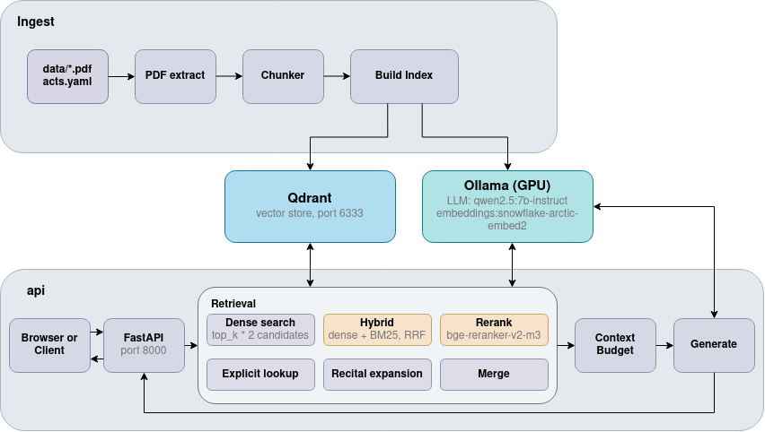

# EU-RAG

*in development*

Local question answering over EU data law, with citations. Ask a question in plain English and get an
answer grounded in the indexed acts, with each statement linked to the article, recital or annex it
comes from (and to EUR-Lex).

Indexed acts (see `data/acts.yaml`):

| Act | Reference |
|---|---|
| GDPR | Regulation (EU) 2016/679 |
| AI Act | Regulation (EU) 2024/1689 |
| Data Act | Regulation (EU) 2023/2854 |
| Data Governance Act | Regulation (EU) 2022/868 |
| ePrivacy Directive | Directive 2002/58/EC |

Everything runs locally.

## Architecture



**Services** (`docker-compose.yml`):

- **ollama**: serves the LLM (`qwen2.5:7b-instruct`) and the embedding model (`snowflake-arctic-embed2`) on the GPU.
  `ollama-init` pulls both on first start.
- **qdrant**: vector store.
- **ingest**: indexes the PDFs, then exits. The API starts only after it has succeeded.
- **api**: FastAPI app with a small web UI on port 8000.

**Code** (`app/eurag/`):

| Module | Role |
|---|---|
| `ingest/pdf_extract.py` | Reading-ordered text from Official Journal and consolidated EUR-Lex PDFs, page furniture removed |
| `ingest/chunker.py` | Splits acts into recitals, articles (by paragraph, max ~1800 chars) and annexes; merges recitals into consolidated texts |
| `ingest/run.py` | Builds the index. A fingerprint over models, chunker version, `acts.yaml` and PDFs decides whether to re-index; the new collection is swapped in atomically behind the alias, so the API never serves a half-built index |
| `retrieval.py` | Dense search (default) or hybrid dense + BM25 with RRF, explicit article lookup, recital expansion, optional reranking |
| `rerank.py` | Cross-encoder `bge-reranker-v2-m3` (fp16 ONNX on the GPU) |
| `generation.py` | Prompt, context budget, citation cleanup, `NOT_COVERED` declines |
| `api.py` | HTTP endpoints and the UI |
| `config.py` | All settings, overridable via environment / `.env` |

Hybrid search and reranking are implemented but **off by default**: in evals neither beat plain dense search.

## Installation

Requirements:

- Docker with Compose v2
- NVIDIA GPU + [NVIDIA Container Toolkit](https://docs.nvidia.com/datacenter/cloud-native/container-toolkit/) (developed on an RTX 3060 Ti, 8 GB)
- ~25 GB disk for models and images

```bash
git clone https://github.com/StefanStricker/eurag.git eurag && cd eurag
cp .env.example .env          # adjust models / ports if needed
docker compose up -d --build
```

Then open <http://localhost:8000>.


## Configuration

Set in `.env` (full list in `app/eurag/config.py`). The most relevant:

| Variable | Default | |
|---|---|---|
| `LLM_MODEL` | `qwen2.5:7b-instruct` | Answer model |
| `EMBED_MODEL` / `EMBED_DIM` | `snowflake-arctic-embed2` / `1024` | Changing it triggers a re-index |
| `TOP_K` | `8` | Chunks passed to the LLM |
| `RETRIEVAL_MODE` | `dense` | `dense` or `hybrid` |
| `RERANK` | `false` | Cross-encoder reranking. On 8 GB also set `QUERY_EMBED_NUM_GPU=0` and `LLM_NUM_GPU=99` |
| `NUM_CTX` / `ANSWER_TOKENS` | `8192` / `1024` | Context window and answer reserve |
| `TEMPERATURE` | `0` | Greedy, for reproducible answers |
| `API_PORT`, `QDRANT_PORT`, `OLLAMA_PORT` | `8000`, `6333`, `11434` | Host ports (bound to 127.0.0.1 only) |

## Evaluation

`evals/questions.yaml` holds 309 questions (synthetic with opus 5.5) with expected articles, across all acts plus
out-of-scope questions that should be declined. `evals/run_evals.py` runs them against the API and
stores each run as JSON in `evals/runs/`. It needs [uv](https://docs.astral.sh/uv/) and a running stack.

```bash
uv run evals/run_evals.py check                        # validate questions against the index
uv run evals/run_evals.py run --label my-change        # full run (answers + retrieval)
uv run evals/run_evals.py run --retrieval-only --label x   # retrieval metrics only, seconds
uv run evals/run_evals.py judge my-change              # LLM judge (mistral-nemo:12b via Ollama)
uv run evals/run_evals.py score my-change --vs act-quota
```


### Results

Reference run `act-quota`: 309 questions, `qwen2.5:7b-instruct` at temperature 0, `snowflake-arctic-embed2`,
dense retrieval with top_k 8, judged by `mistral-nemo:12b`, RTX 3060 Ti 8 GB.

| Metric | Score | Meaning |
|---|---:|---|
| Retrieval recall | 0.95 | Required articles/annexes among the retrieved chunks |
| MRR | 0.76 | 1 / rank of the first expected unit |
| Citation hit | 0.93 | At least one expected unit is cited |
| Citation recall | 0.91 | Share of required units cited |
| Citation precision | 0.82 | Share of cited articles/annexes that are expected |
| Paragraph recall | 0.88 | Expected paragraphs covered by a citation |
| Judged correct | 0.96 | LLM judge: correct = 1, partial = 0.5 |
| Judged faithful | 0.997 | Every claim is supported by the cited sources |
| False declines | 2.1 % | Answerable questions that were declined |
| Out-of-scope declined | 100 % | Out-of-scope questions correctly declined |
| Latency (mean / p95) | 2.9 s / 5.9 s | End-to-end, non-streaming |

| Category | n | Retrieval recall | Citation recall | Citation precision | Judged correct |
|---|---:|---:|---:|---:|---:|
| GDPR | 70 | 0.97 | 0.96 | 0.85 | 0.96 |
| AI Act | 80 | 0.95 | 0.93 | 0.81 | 0.99 |
| Data Act | 50 | 0.94 | 0.85 | 0.76 | 0.93 |
| Data Governance Act | 38 | 1.00 | 0.97 | 0.89 | 0.97 |
| ePrivacy Directive | 26 | 1.00 | 0.92 | 0.88 | 0.94 |
| Cross-document | 26 | 0.81 | 0.69 | 0.73 | 0.92 |
| Annex questions | 11 | 0.82 | 0.73 | 0.95 | 1.00 |
| Out-of-scope | 19 | – | – | – | 19/19 declined |


## Tests

```bash
docker compose run --rm api pytest
```

The tests cover the chunker (against the real PDFs in `data/`) and the citation/decline handling.

## Limitations

- English only.
- No amendment tracking: each act is indexed as one version (see `acts.yaml`).
- Answers come from a 7B model and are research aids, not legal advice.
